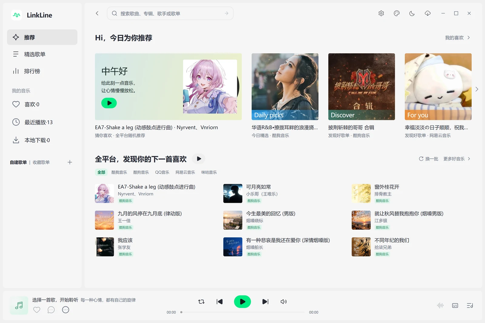
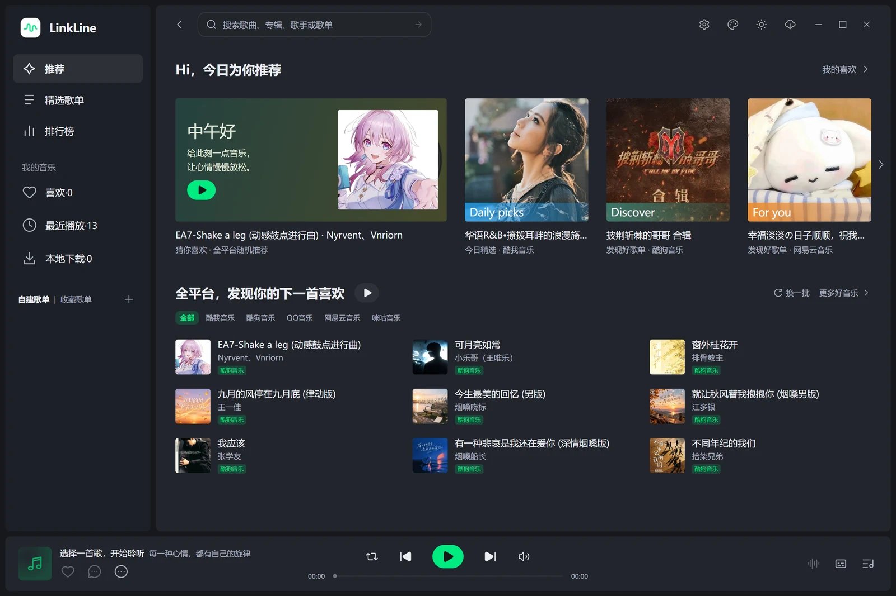
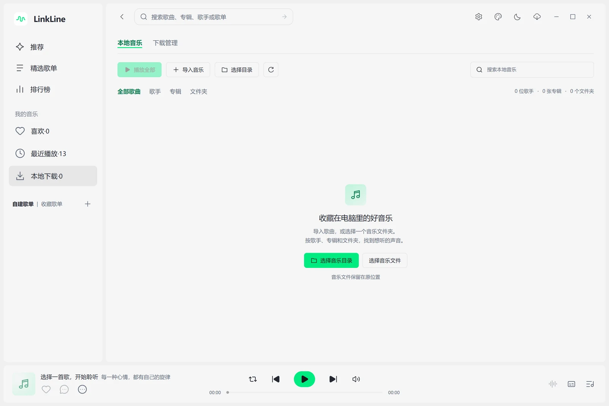
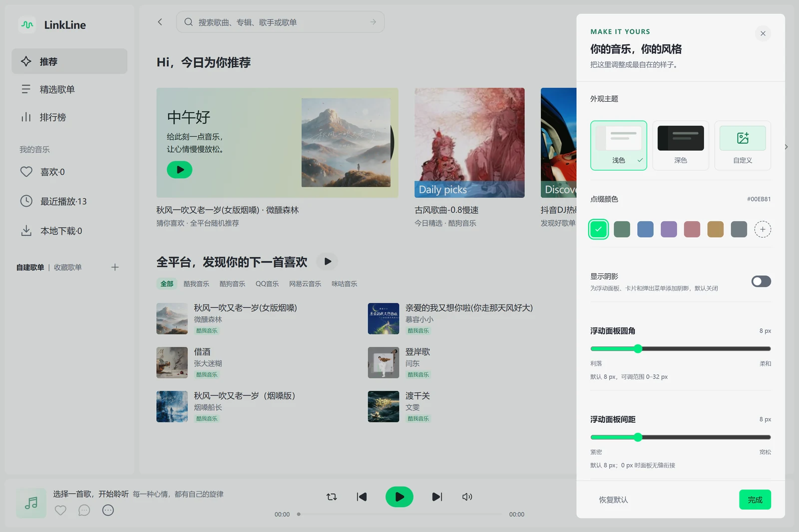

<p align="center">
  
</p>

<h1 align="center">Mix Music</h1>

<p align="center"><strong>把不同平台的音乐，连接到同一个音乐空间。</strong></p>

<p align="center">
  跨平台音乐库 · 沉浸播放器 · 三种外部歌词 · 自定义外观
</p>

<p align="center">
  <a href="https://github.com/Destroyer236/Mix-Music/releases/latest"></a>
  
  <a href="LICENSE"></a>
</p>

<p align="center">
  <a href="https://github.com/Destroyer236/Mix-Music/releases/download/v1.3.5/MixMusic-v1.3.5-x64-Setup.exe"><strong>下载 Windows 版</strong></a> ·
  <a href="https://gh-proxy.com/https://github.com/Destroyer236/Mix-Music/releases/download/v1.3.5/MixMusic-v1.3.5-x64-Setup.exe">国内加速下载</a> ·
  <a href="docs/项目说明.md">使用手册</a> ·
  <a href="https://github.com/Destroyer236/Mix-Music/issues">反馈问题</a>
</p>

Mix Music 是一款基于 LXMusic 开源项目再开发的桌面音乐应用。连接平台账号，汇总喜欢的歌曲与自建歌单；导入本地音乐，按歌手、专辑和文件夹整理。用随主题变化的沉浸播放器、滚动歌词与独立外部歌词，听见分散在不同地方的音乐。

<p align="center">
  <a href="docs/images/readme/home-light.webp"></a>
  <br>
  <sub>浅色主题 · 推荐页 · 无描边浮动面板</sub>
</p>

## 看看 Mix Music

<table>
  <tr>
    <td width="50%" align="center">
      <a href="docs/images/readme/home-dark.webp"></a>
      <br><strong>深色主题</strong><br><sub>在浅色与深色之间自由切换</sub>
    </td>
    <td width="50%" align="center">
      <a href="docs/images/readme/playlists.webp"></a>
      <br><strong>精选歌单</strong><br><sub>按平台与分类，发现下一首喜欢的歌</sub>
    </td>
  </tr>
  <tr>
    <td width="50%" align="center">
      <a href="docs/images/readme/local-library.webp"></a>
      <br><strong>本地音乐</strong><br><sub>歌曲、歌手、专辑、文件夹，四种整理方式</sub>
    </td>
    <td width="50%" align="center">
      <a href="docs/images/readme/appearance.webp"></a>
      <br><strong>你的外观</strong><br><sub>配色、圆角、间距与图片主题，自由调整</sub>
    </td>
  </tr>
</table>

*截图来自 Mix Music 1.1.0；点击图片可查看大图。*

## 为听歌而设计

| | 你可以做什么 |
| --- | --- |
| **把喜欢的音乐放在一起** | 汇总已连接平台的红心歌曲，同步平台创建的歌单；主动收藏时，在支持写入的平台查找同版本歌曲并分别操作。 |
| **找到想听的内容** | 搜索歌曲、歌手、专辑与歌单；浏览推荐、精选歌单和排行榜，查看最近播放，点击歌手或专辑进入相关作品。 |
| **选择合适的音质** | 默认使用账号最高可用音质，支持标准、无损、Hi-Res 等平台音质；原平台无法播放时，尝试其他平台的同版本歌曲。 |
| **整理本地音乐** | 导入文件或递归扫描文件夹，不设导入数量上限；按歌曲、歌手、专辑和文件夹分类，支持搜索与批量操作。 |
| **专注当前这首歌** | 方形、黑胶与全屏封面布局，封面模糊或流动光影背景；闲置时淡出操作栏，随软件的浅色、深色和图片主题调整面板。 |
| **让歌词陪着你** | 逐字高亮、翻译、罗马音、字号与上下间距调整；选择歌词复制或导出图片。桌面、灵动岛、Windows 任务栏歌词可独立设置、同时开启。 |
| **换一种方式发现音乐** | 推荐播放可自动追加下一批歌曲；登录网易云音乐后，从「喜欢」旁的心动按钮开启平台心动推荐。 |
| **用你喜欢的样子听歌** | 浅色、深色与自定义图片主题；调整点缀色、面板圆角和间距，选择显示阴影或滚动条。 |
| **按自己的习惯播放** | 列表循环、随机、单曲循环和顺序播放；搜索与整理队列，使用均衡器、变速、升降调、A/B 片段循环、定时暂停及输出设备选择。关闭窗口可最小化到托盘。 |
| **在应用内完成升级** | 启动时检查新版本，更新页面展示下载进度，完成后点击安装；支持官方和国内加速入口。 |

在线播放、音质和下载取决于歌曲版权、平台接口、账号权限与网络。跨平台换源会查找同版本歌曲，不会绕过会员或版权限制。更多细节见[完整功能与使用手册](docs/项目说明.md)。

歌曲列表展示平台来源与 VIP 标识，播放器标明实际播放音源、音质和试听状态。可在「设置与偏好 → 音源与播放 → 全局首选音源」选择平台或导入音源。自动时优先使用歌曲所属的已登录平台，否则从及时响应的音源中优选音质；首选音源不可用时自动换源，完整音频优先于平台允许的试听片段。VIP 标识取决于平台提供的歌曲权限信息，尚未返回权限信息的歌曲不作推断。

## 下载与安装

当前版本 **1.3.5**，支持 **Windows 10 / 11，64 位（x64）**。

| 下载入口 | 链接 |
| --- | --- |
| GitHub 官方 | [下载 MixMusic-v1.3.5-x64-Setup.exe](https://github.com/Destroyer236/Mix-Music/releases/download/v1.3.5/MixMusic-v1.3.5-x64-Setup.exe) |
| 国内加速 | [gh-proxy.com](https://gh-proxy.com/https://github.com/Destroyer236/Mix-Music/releases/download/v1.3.5/MixMusic-v1.3.5-x64-Setup.exe) · [备用 ghfast.top](https://ghfast.top/https://github.com/Destroyer236/Mix-Music/releases/download/v1.3.5/MixMusic-v1.3.5-x64-Setup.exe) |
| 版本与校验 | [所有正式版本](https://github.com/Destroyer236/Mix-Music/releases) · [SHA-256 校验文件](https://github.com/Destroyer236/Mix-Music/releases/download/v1.3.5/SHA256SUMS.txt) |

下载后运行安装程序，按提示完成安装。国内入口由第三方服务转发官方文件，连接失败时可切换官方或备用入口。已有用户可在应用内的「检查更新」下载安装包，升级前可导出备份。

### 三步开始听歌

1. **连接账号**：首次启动后，打开「设置与偏好 → 平台账号与红心」，按对应平台的扫码或官方网页提示完成登录。
2. **同步音乐库**：点击「同步音乐库」或「同步全部」，在侧栏「喜欢」查看聚合红心，在「自建歌单」查看已同步歌单。
3. **选择歌曲播放**：从音乐库、搜索或精选内容中播放；也可进入「本地下载 → 本地音乐」，导入自己的音频文件。

QQ 音乐使用手机 QQ 扫描应用内二维码，也可打开内嵌的官方登录页，用账号密码或微信扫码登录；网易云音乐使用网易云音乐 App 扫码；汽水、波点使用对应音乐 App 扫码。其他平台的扫码、密码或短信登录以平台官网展示的方式为准。软件默认不附带或自动导入音源脚本；需要时可在「音源与播放」中手动导入兼容脚本。旧版自动添加的预置音源会在读取列表时移除，对应选中设置恢复默认；用户手动导入的脚本继续保留。

## 平台支持

| 平台 | 登录方式 | 红心 / 收藏同步 | 自建歌单 / 收藏夹同步 | 跨平台收藏操作 |
| --- | --- | --- | --- | --- |
| QQ 音乐 | 手机 QQ 扫码 | 支持 | 支持 | 支持 |
| 网易云音乐 | 网易云音乐 App 扫码 | 支持 | 支持 | 支持 |
| 汽水音乐（实验性） | 汽水音乐 App 扫码，按需官方安全验证 | 已接入，需实号验证 | 已接入，需实号验证 | 已接入，按版权及匹配结果操作 |
| 波点音乐（实验性） | 波点 App 扫码 | 已接入，需实号验证 | 已接入，需实号验证 | 已接入，按版权及匹配结果操作 |
| 咪咕音乐 | 应用内手机号验证码登录 | 支持 | 支持 | 支持 |
| 哔哩哔哩 | 支持 | 默认收藏夹聚合 | 自建收藏夹 | 收藏操作 |
| 酷狗音乐 | 官网网页登录 | 暂不支持 | 暂不支持 | 暂不支持 |
| 酷我音乐 | 官网网页登录 | 暂不支持 | 暂不支持 | 暂不支持 |

酷狗与酷我目前提供公开播放能力和官方登录入口，尚不支持云收藏同步。哔哩哔哩按视频 / 音轨和收藏夹处理。平台接口可能变化；登录或同步成功不代表获得所有歌曲的播放权限。

汽水音乐为实验性适配：在「平台账号与红心」使用汽水音乐 App 的「扫一扫」，手机确认后若平台要求验证码或身份验证，会显示独立的官方安全验证窗口；完成后继续登录并同步红心及歌单。查询临时受限时会等待自动重试，验证窗口出现时间取决于平台响应。搜索页可选择汽水音乐，歌单导入支持分享链接或 ID；未登录或完整搜索受限时，只展示搜索联想实际返回的有限结果。音频与歌词来自官方分享及歌曲接口，支持刷新音频信息、原声片段和主备播放地址；网页权限可能与 App 不同，受保护、仅试听或版权受限的资源不作完整播放。暂不提供原生无损、Hi-Res 等音质切换，真实账号同步及收藏写入仍需结合实际账号验证。

波点音乐为实验性适配：在设置中使用波点音乐 App 扫码，确认后同步红心、自建及收藏歌单；支持歌曲、歌单、专辑、歌手搜索、歌单链接导入、歌词和官方音频。按平台实际返回的格式展示音质，会员试听会标记「试听」并优先尝试其他平台的完整歌曲。公开接口及二维码已验证，真实账号授权后的同步和收藏写入仍需本人测试。账号设置顺序为 QQ 音乐、网易云音乐、汽水音乐、波点音乐，再到其他平台。

## 1.2.1 有什么新变化

- 换用「拍点」Logo 与几何 Mix Music 字标，左上角品牌缩小并靠左排列，同步应用、安装包及托盘图标。
- 改进任务栏歌词在任务栏重建、宿主异常后的自动恢复；翻译显示独立于双行开关，修复部分缩放比例下外部歌词窗口尺寸变化。
- QQ 音乐、网易云音乐使用应用内二维码登录；汽水音乐改用汽水 App 扫码，按平台要求显示官方验证码 / 身份验证窗口。
- 改进汽水分享音频刷新、原声片段与官方播放器主备地址处理，探测连接并尝试其他有效候选；网页权限、版权及受保护内容的限制仍然适用。
- 补全网易云增强音质查询与实际规格展示；Audio Vivid 因当前播放器不支持 AV3A 解码而禁选。
- 播放器调整歌词、队列及更多入口，增加「减少推荐」，将歌曲加入本机不喜欢库并从后续推荐和续播中排除。
- 在线音频加载失败时排除失效地址并重新解析 / 换源，改进导入音源的播放下载适配及默认脚本缓存。
- 更新中心支持排版显示发行说明；调整歌单详情留白、批量操作区域和侧栏封面占位。

升级会保留已保存的外观和歌词偏好。播放器的封面、背景和沉浸设置位于「更多播放器功能 → 播放器外观」，歌词字号与间距位于歌词区域的设置菜单。

[完整发行说明](docs/releases/v1.2.1.md) · [更新日志](CHANGELOG.md) · [外部歌词说明](docs/external-lyrics.md) · [性能优化说明](docs/性能优化说明.md)

## 开发与资料

[使用手册](docs/项目说明.md)涵盖歌词、下载、快捷键、账号同步、数据备份及常见问题。源码反馈请通过 [Issues](https://github.com/Destroyer236/Mix-Music/issues) 提交。

<details>
<summary><strong>从源码运行与构建</strong></summary>

需要 Node.js 22 或更新版本、npm 8.5.2 或更新版本。

```sh
npm install
npm run dev
```

生产构建、桌面启动与代码检查：

```sh
npm run build
npm start
npm run lint
```

Windows x64 安装包：

```sh
npm run build
npm run pack:win:setup:x64
```

安装包输出到 `build/`。`npm run release:prepare` 根据安装包与发行说明生成更新清单和 SHA-256 文件，不会自动上传或发布。

主要目录：`src/renderer/ui/` 为主界面，`src/renderer-lyric/ui/` 为桌面歌词，`src/main/` 为 Electron 与平台服务，`src/common/` 为共享类型与配置。

</details>

<details>
<summary><strong>数据、备份与运行资源</strong></summary>

正常安装的数据目录为 `%APPDATA%\Mix Music`，音乐资料位于其中的 `LxDatas`。登录会话、音乐库与设置保存在本机；源码测试脚本默认使用项目内的 `artifacts/user-test-data`，与正式安装分开。

在「设置与偏好 → 备份与数据」导入导出音乐库与偏好设置。备份不会复制原始音频文件或平台登录会话，详见[数据存储、备份与迁移](docs/项目说明.md#数据存储备份与迁移)。

硬件加速默认开启，可在设置中关闭并重启生效。软件按需加载服务与 Worker，限制缓存和 V8 旧生代预算；预算不是应用总内存上限，实际占用取决于内容与设备，详见[性能优化说明](docs/性能优化说明.md)。

</details>

## 许可与归属

**作者：[Zephyr](https://github.com/Destroyer236)**（[@Destroyer236](https://github.com/Destroyer236)）

Mix Music 基于 [LXMusic 开源项目](https://github.com/lyswhut/lx-music-desktop)再开发，保留原作者版权声明，遵循 [Apache License 2.0](LICENSE)。第三方组件保留[各自许可](licenses/)，音乐与平台内容的权利归各自权利人所有。

播放器、外部歌词与心动模式的交互参考 [SPlayer-Next](https://github.com/SPlayer-Dev/SPlayer-Next)，汽水登录及音频获取流程参考 [sodam](https://github.com/sodahub-org/sodam) 的公开实现，结合 Mix Music 既有播放服务、歌词格式与 Electron 窗口独立适配；原项目保留其版权与许可。感谢相关开源项目的作者与贡献者。
